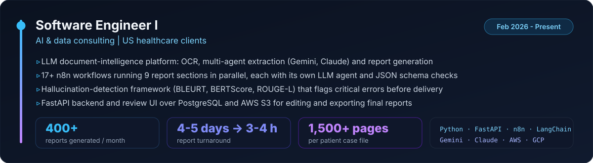

  

  
  
  
  

 

## 💼 Experience

  

 

## 🚀 Featured projects

<table>
  <tr>
    <td width="50%"></td>
    <td width="50%"></td>
  </tr>
  <tr>
    <td width="50%"></td>
    <td width="50%"></td>
  </tr>
</table>

 

## 🧰 Tech stack

<table>
  <tr>
    <td align="center" width="140"><b>Languages</b></td>
    <td></td>
  </tr>
  <tr>
    <td align="center"><b>AI / ML</b></td>
    <td>
       
      
      
      
      
      
      
    </td>
  </tr>
  <tr>
    <td align="center"><b>MLOps</b></td>
    <td>
      
      
      
      
      
    </td>
  </tr>
  <tr>
    <td align="center"><b>Backend &amp; data</b></td>
    <td>
       
      
      
      
      
    </td>
  </tr>
  <tr>
    <td align="center"><b>Cloud</b></td>
    <td></td>
  </tr>
</table>

 

## 🎓 Education & achievements

| | |
|---|---|
| 🎓 **B.Tech, Computer Science (Data Science)** | R. C. Patel Institute of Technology, Shirpur, 2022 - 2026 |
| 📜 **Research paper** | AI-driven crop disease detection, published in IJSTM |
| ☁️ **Certification** | Oracle OCI 2025 Data Science Professional |
| 👥 **Data Polaris** | Technical team member of the college coding club |

 

## 📈 GitHub activity

  
  

  

<i>Clean data. Honest evaluation. Models you can actually call.</i>

